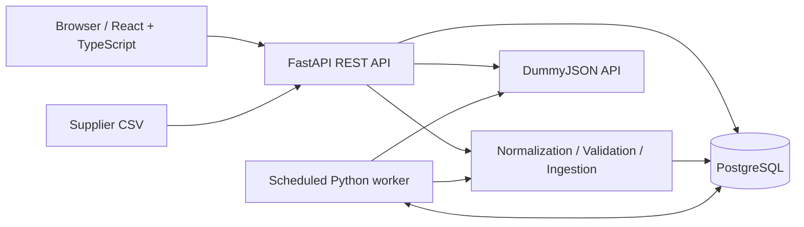

# DataBridge

**Data integration, validation and traceability — in one local-first operations workspace.**

DataBridge is an engineering portfolio project that brings inconsistent supplier data into a consistent, searchable catalog. It accepts CSV uploads and product data from an allowlisted REST API, validates records, stores provenance, and displays data-quality metrics and scheduled-import activity.

**Status:** local development / portfolio MVP. **Not production-ready:** no authentication or multi-tenant isolation. Do not expose the API or Docker ports to the public internet.

> **UI:** German · **Tech:** React, TypeScript, FastAPI, Python, PostgreSQL, SQLAlchemy, Docker Compose · **Tests:** Pytest · **Automation:** dedicated Python worker

## What you can do

| Capability | What DataBridge demonstrates |
| --- | --- |
| CSV ingestion and column mapping | Handle supplier-specific schemas; preview and validate before ingesting |
| REST API connector | Fetch 20 sample products from DummyJSON using a fixed HTTPS endpoint |
| Normalization and validation | Parse localized EUR amounts, validate fields, reject invalid rows with explanations |
| Idempotent import | Re-import an existing `(source_name, external_id)` without creating another offer |
| Data lineage | Inspect source payloads, normalized values and before/after change events |
| Scheduled import monitoring | Run an opt-in worker, persist execution states, and retry failed requests with backoff |
| Data quality analytics | Inspect accepted/rejected source rows, per-source metrics and validation issues |
| Product catalog | Server-side search, source filter, sorting, pagination, detail view and CSV export |

The API demo returns product prices **without a documented currency**. DataBridge records these with the ISO code `XXX` (no currency), not as EUR prices. CSV examples use EUR.

## System overview



`SourceRow` preserves the incoming row, `SupplierOffer` holds the latest offer state, and `OfferEvent` records decisions and before/after values. Import and validation records provide the audit trail.

For detailed design choices, limitations and the database entities, see [Architecture](docs/ARCHITECTURE.md).

## Run locally

**Requirements:** Docker Desktop with Docker Compose; on Windows, WSL2 / virtualization must be enabled.

```bash
docker compose up -d --build
```

- Frontend: http://localhost:5173
- API docs: http://localhost:8000/docs
- Health endpoint: http://localhost:8000/api/health

The `compose.yaml` uses **local-development credentials** and binds HTTP ports to `127.0.0.1`. Those credentials are not suitable for any deployment.

To stop the application without deleting data:

```bash
docker compose stop
```

**Never use `docker compose down -v` if you want to keep the local database.**

## Try the demo

1. Open **Daten importieren**, select `demo-data/lieferant_a.csv`, set the source to `Lieferant A`, and map the columns. The sample includes deliberately invalid lines.
2. Open **API-Connector**, fetch a preview and import the 20 sample products.
3. Import `demo-data/lieferant_a_update.csv` with the **same** source name to create example change events.
4. Inspect **Importhistorie** and an individual product's **Verlauf** to trace original input and before/after values.
5. Open **Datenqualität** to see source-level acceptance metrics. Explore **Produktkatalog** with search, filters, sorting and filtered CSV export.
6. Optionally enable **Automatisierung** locally, enqueue a run and inspect the recorded result; disable it afterward.

A walkthrough and presentation checklist are available in [Demo Guide](docs/DEMO_GUIDE.md).

## Tests and reproducible benchmark

The backend suite is configured to use an **isolated SQLite test database**; it must never operate against the normal PostgreSQL data volume.

```bash
# Backend tests
docker compose run --rm backend python -m pytest -q

# Frontend TypeScript check and production bundle
docker compose run --rm frontend npm run build

# Isolated ingestion benchmark (NOT a PostgreSQL production benchmark)
docker compose run --rm backend python benchmark.py --rows 1000 --repeats 3
```

**Verification:** 30 backend tests passed when this portfolio preparation was assembled, using SQLite isolation. The frontend build has previously passed locally; rerun it after any new frontend changes.

**Example measured benchmark** (1,000 synthetic rows × 3 runs, SQLite in-memory, median):

| Operation | Median elapsed | Throughput |
| --- | ---: | ---: |
| Initial ingestion | 0.709 s | 1,411 rows/s |
| Repeated identical ingestion | 0.577 s | 1,733.5 rows/s |

The repeated import created **0 duplicate offers** in that test. These values were observed during local development; they do **not** measure full HTTP, file upload, production PostgreSQL, concurrency or cloud performance. Hardware specifications were not recorded. See [Benchmark methodology](docs/QUALITY_AND_BENCHMARK.md).

## Project structure

```text
backend/app/          HTTP API, ORM models, ingestion, connector, scheduler
backend/tests/        Backend regression and integration-style tests (SQLite)
backend/benchmark.py  Isolated synthetic ingestion benchmark
frontend/src/         React UI and Corporate design system
  corporate.css       Green/white enterprise visual language
demo-data/            Sample CSV files (synthetic)
docs/                 Architecture, demo, case study and release checklist
.github/workflows/    CI for Python, frontend build and backend Docker packaging
compose.yaml          Local-only services: db, backend, worker, frontend
```

## Scope and security

This is an educational / portfolio MVP, **not** a hosted enterprise product. It currently lacks authentication, access controls, organization isolation, secret management for real suppliers, and production deployment hardening. The scheduler is designed around one local worker and a fixed demo connector. Do not upload confidential supplier data or publish the running API unchanged.

See [Security and limitations](docs/SECURITY.md) and [Pre-publication checklist](docs/PRE_PUBLISH_CHECKLIST.md).

## Engineering case study

[Problem → design decisions → reliability measures → measured evidence → limitations](docs/CASE_STUDY.md)

*Note: this project was iteratively developed and reviewed with AI coding assistance; all public claims should be grounded in reproducible tests and code that the maintainer can explain.*
