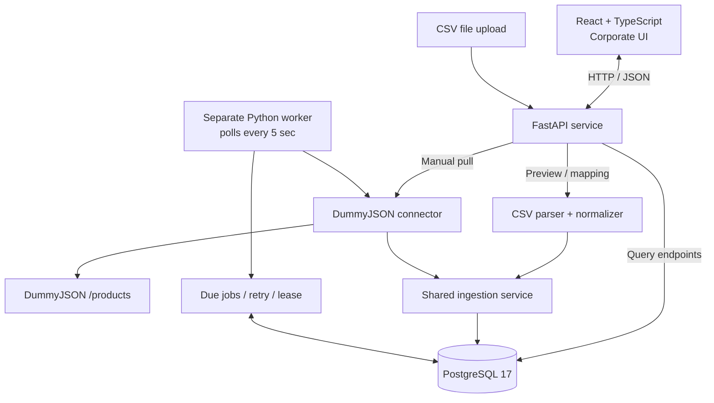
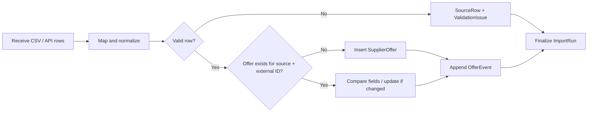

# DataBridge — Architecture (local portfolio MVP)

## Design goal

Import heterogeneous supplier offer data from a CSV file or fixed REST connector, reject invalid rows with reasons, preserve source-to-offer lineage, and expose the resulting information through a usable operations UI. Reliability and interpretability are prioritized over maximum throughput.

## Components

- **Frontend:** React/TypeScript with a green/white enterprise design. Uses API responses; no direct SQL access.
- **API:** FastAPI validates requests, handles CSV file uploads and the allowlisted DummyJSON connector, and provides catalog, analytics, history and scheduling endpoints.
- **Database:** PostgreSQL persists offers, source rows, validation issues, import runs, change events, and worker state.
- **Worker:** `python -m app.scheduler_worker` runs independently from the API, claims due jobs in PostgreSQL, executes the fixed connector and writes execution outcomes. It does not depend on keeping a browser tab open.

## Ingestion lifecycle

- CSV upload is limited to 5 MiB; mapping assigns source columns to the expected product fields.
- Both CSV and API rows share `persist_rows` with a source-specific normalizer.
- The unique offer key is `(source_name, external_id)` — the code does **not** infer that differently numbered supplier products refer to the same real-world product.
- `ImportRun` tracks inserted, updated, unchanged and rejected rows. `SourceRow` preserves raw payloads; `ValidationIssue` provides explanations for rejected inputs.
- `OfferEvent` links a processed row to the resulting offer and its before/after snapshots; **old imports predating v0.3 do not get fabricated history**.
- One import's database changes commit together, or roll back together on an unexpected exception. Per-row validation failures are recorded instead of aborting the whole batch.

## Persistent tables

| Entity | Responsibility |
| --- | --- |
| `import_runs` | Execution metadata and row counts for imports |
| `source_rows` | Original incoming CSV/API payload for each row |
| `validation_issues` | Field-level error codes and messages |
| `supplier_offers` | Latest known offer state, unique per supplier and external ID |
| `offer_events` | Auditable insert/update/unchanged decisions and snapshots |
| `pipeline_schedules` | Opt-in interval, next run, retry count, lease and current state |
| `pipeline_executions` | Success/failure record for each scheduled attempt |

## Scheduler behavior

The scheduler is deliberately **not embedded inside FastAPI**. A single Docker worker polls every five seconds, claims due jobs using database state (with row locking on PostgreSQL), then attempts the fixed DummyJSON fetch.

- Scheduling is disabled by default, until a user opts in.
- Completed runs receive a new scheduled time; failed runs are logged and retried with a capped exponential delay.
- A temporary lease allows recovery if a process dies mid-attempt. API fetch failures are recorded without creating a partial import.
- Current limits: no multi-connector administration, no multi-tenant scheduling, and no robust production queue or long-running-job heartbeat.

## Catalog, quality and reporting

- `/api/catalog/offers` performs **server-side** search, source filtering, sorting and pagination; it does not search only the first 100 displayed rows.
- `/api/catalog/export.csv` exports the *entire filtered result* up to 10,000 rows, includes a UTF-8 BOM and neutralizes common spreadsheet formula prefixes in untrusted fields.
- `/api/offers/{id}/lineage` returns the product's traceable change events.
- `/api/analytics/quality` computes acceptance metrics from completed imports. Repeated imports count as new *processed rows*, not new unique products; multiple issues can correspond to one rejected row.
- DummyJSON's numeric price has no trusted currency. `XXX` signals unknown currency; such values should never be presented as EUR.

## Test isolation (important incident and corrective action)

An earlier test suite accidentally imported application database configuration before switching to SQLite, which allowed a destructive fixture to target the local PostgreSQL database. This was discovered during local development and corrected. `backend/tests/conftest.py` now establishes a SQLite test URL **before importing application code** and refuses test execution if the engine is not SQLite.

Use `python -m pytest -q` rather than a custom database URL. Do not remove the safety guard or point test fixtures at the application database. Back up persistent data before any migration or manual database work.

## Known limitations

- Local-only prototype: no authentication, authorization, tenant isolation or public deployment configuration.
- No production-grade migration process (the MVP uses legacy schema updates and `create_all`; a mature system should use versioned Alembic migrations).
- The ingestion path uses row-by-row ORM operations, not optimized batch ingest.
- Scheduler is designed for a single local worker, not a distributed worker fleet.
- Data quality measures technical acceptance only; it does not guarantee supplier truth, freshness or semantic matching accuracy.
- The isolated SQLite benchmark is not a production PostgreSQL throughput claim.
